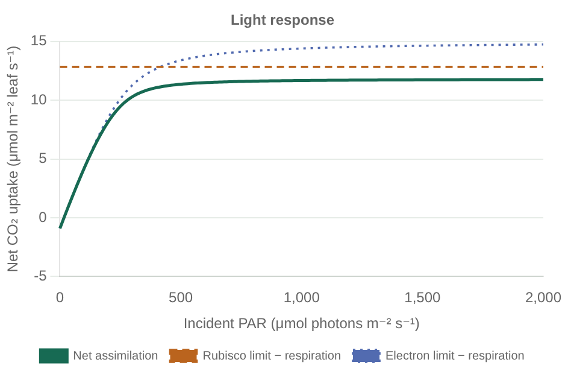
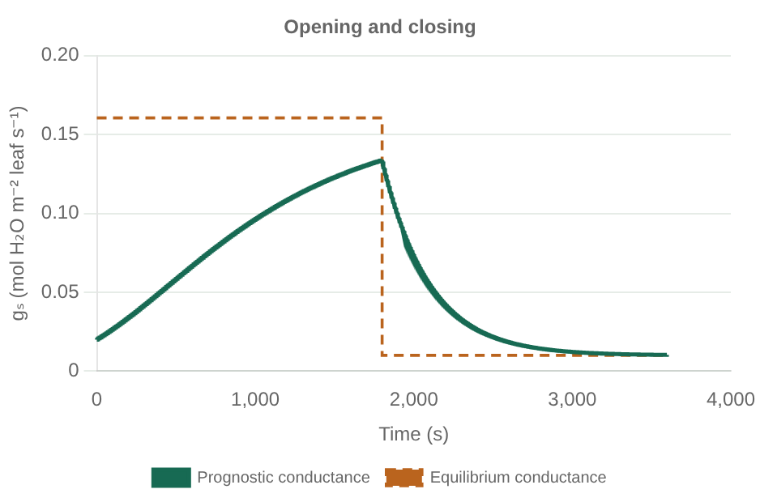

# Worked examples

Open the [live GitHub Pages gallery](https://rsfralab.github.io/LeafPhotosynthesis.jl/examples.html)
or open [examples.html](examples.html) **from your local checkout** for the interactive
Chart.js gallery, and browse the [structured API Reference](api/README.md) for all
exported types, status codes, and functions grouped by biophysical process. Viewing `examples.html` inside the GitHub repository tree displays HTML
source rather than executing it. The gallery works completely offline: the plotting
library and both FP32/FP64 datasets are bundled locally.

The gallery includes labeled response curves, keyboard-accessible series controls,
hover values, complete data tables, CSV downloads, PNG export, and the actual source
of each runnable example. Plots are saved Julia outputs; JavaScript does not implement
or approximate the physiology.

| Start with | What it shows |
| --- | --- |
| [one_leaf.jl](../examples/one_leaf.jl) | Prescribed inputs and a single photosynthesis call |
| [bonan_11_1.jl](../examples/bonan_11_1.jl) | Light, internal CO₂, and temperature responses |
| [core_exchange.jl](../examples/core_exchange.jl) | Coupled equilibrium, O₂, and fixed-temperature derivatives |
| [stomatal_response.jl](../examples/stomatal_response.jl) | Opening in light, closing in darkness, and comparison with equilibrium |
| [biochemical_turnover.jl](../examples/biochemical_turnover.jl) | Available and realized electrons, including carbon cancellation at compensation |
| [oxygen_response.jl](../examples/oxygen_response.jl) | Explicit O₂-dependent compensation point and coupled carbon uptake |
| [fluorescence.jl](../examples/fluorescence.jl) | Shared PSII excitation, replaceable quenching and internal fluorescence |
| [cytochrome_stress.jl](../examples/cytochrome_stress.jl) | Empirical van der Tol vs. mechanistic Johnson & Berry Cytochrome $b_6f$ fluorescence under light, drought and capacity stress |
| [johnson_berry_2021.jl](../examples/johnson_berry_2021.jl) | Johnson & Berry (2021) PSII connectivity (Case 9), closed-form state transitions `qT` (Case 10), capacity scaling (Case 12), and PAM PSI leakage |

TOML parsing is isolated in [read_parameters.jl](../examples/setup/read_parameters.jl).
Explicit component assembly lives in [bonan_leaf.jl](../examples/setup/bonan_leaf.jl)
and [core_leaf.jl](../examples/setup/core_leaf.jl). Output formatting lives in
[write_tables.jl](../examples/setup/write_tables.jl). The main examples focus on
calling the production physics. Named parameter values and units remain in TOML.

## Preview





See all three [Bonan curves](bonan_exercises.md) and the
[stomatal and gas-exchange plots](core_exchange.md) in the Markdown documentation.
The [biochemical turnover walkthrough](biochemical_turnover.md) includes electron
and gross carbon flux plots.
The [fluorescence walkthrough](fluorescence.md) distinguishes internal PSII
production from leaf optical escape and explains valid dark plot gaps.
The [Cytochrome $b_6f$ stress walkthrough](cytochrome_fluorescence.md) compares
empirical PSII quenching fits against coupled PSII/PSI + Cytochrome $b_6f$ feedback
quenching across irradiance, stomatal CO₂ drawdown, and Rubisco vs. thylakoid stress.
Static previews use Float64; the interactive gallery lets you choose either precision.

## Reproduce the plots

From the repository root:

```sh
julia --project=. examples/one_leaf.jl
julia --project=. examples/bonan_11_1.jl
julia --project=. examples/core_exchange.jl
julia --project=. examples/stomatal_response.jl
julia --project=. examples/biochemical_turnover.jl
julia --project=. examples/oxygen_response.jl
julia --project=. examples/fluorescence.jl
julia --project=. examples/cytochrome_stress.jl
julia --project=. examples/johnson_berry_2021.jl
julia --project=. docs/build_examples.jl
julia --project=. docs/build_api_docs.jl
```

`docs/build_api_docs.jl` regenerates `docs/api/*.md` from the package docstrings (`--check` verifies zero drift), and `julia --project=docs -e 'using Pkg; Pkg.develop(PackageSpec(path=pwd())); Pkg.instantiate()' && julia --project=docs docs/make.jl` builds the local `Documenter.jl` HTML site in `docs/build/`.

The builder calls the example functions directly, then writes the CSV tables and
`assets/examples-data.js`. It embeds the current example source, so the displayed
code is generated rather than maintained as a second implementation. The builder
fails on a nonconverged equilibrium or nonfinite plot value. Numerical formatting,
JSON serialization, and browser presentation stay outside the model and examples.
Reopen `examples.html` after rebuilding. No npm, web server, or network is needed.

For a quick figure, use **Save PNG** under a plot. To regenerate all twenty-one committed
Markdown previews with a browser, the optional maintainer workflow is:

```sh
npm install --no-save --package-lock=false --prefix docs playwright@1.56.1
./docs/node_modules/.bin/playwright install chromium
node docs/export_figures.cjs
```

These tools are documentation-only dependencies. `LEAF_DOCS_CHROMIUM` may point to
an existing Chromium executable. Run `docs/build_examples.jl` before exporting
previews after changing parameters. Keep regenerated data and previews in the same
commit. Chart.js version and licenses are recorded in [vendor/README.md](assets/vendor/README.md).

Bonan 11.1 has independent high-precision equation checks, but no executed MATLAB
comparison yet. The equilibrium and stomatal examples use illustrative settings;
they are not reproductions of Bonan 12.1 or a fit to observed time courses.
