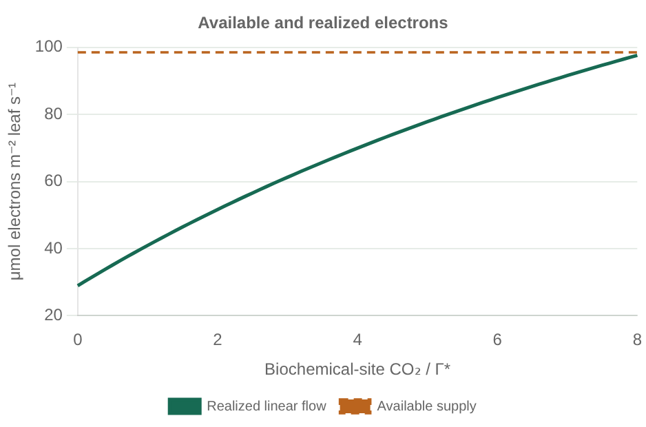
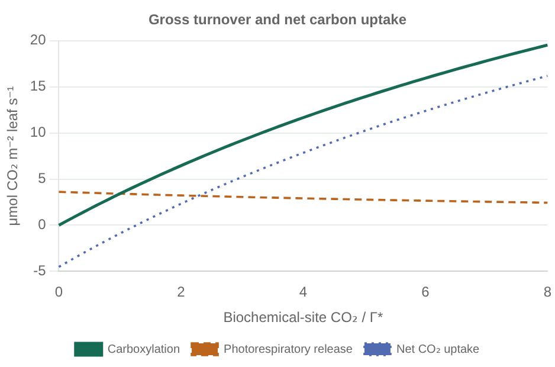

# Electron use and biochemical turnover

`biochemical_turnover(leaf, environment)` exposes carboxylation,
photorespiratory CO₂ release, respiration, realized linear electron flow, and
available electron supply. It works with `NoOxygenExchange()`; requesting these
diagnostics does not enable an oxygen calculation.

Run [biochemical_turnover.jl](../examples/biochemical_turnover.jl) to sweep
prescribed biochemical-site CO₂ at fixed light and temperature. Its
[setup file](../examples/setup/turnover_experiment.jl) handles parameter reading
and assembly. The [sweep settings](../examples/parameters/turnover.toml),
[biochemistry](../examples/parameters/bonan_11_1.toml), and
[core component choices](../examples/parameters/core_exchange.toml) are explicit.
This is an illustrative diagnostic, not an additional Bonan exercise.

```sh
julia --project=. examples/biochemical_turnover.jl
julia --project=. docs/build_examples.jl
```





These are Float64 previews. The [offline gallery](examples.html#turnover) offers
both precisions, complete tables, and CSV/PNG downloads. The calculation prescribes
CO₂ at the biochemical site; it does not solve stomatal or mesophyll diffusion.

## Equations and units

Let C and O be biochemical-site CO₂ and O₂ partial pressures [Pa], Γ* the
photorespiratory compensation point [Pa], J the available electron supply
[μmol electrons m⁻² leaf s⁻¹], and e and a the explicitly supplied
`electrons_per_carboxylation` and `oxygenation_cost`. The existing model combines
the two positive capacities

```
u_c = Vcmax / (C + Kc (1 + O/Ko))
u_j = J / (e (C + a Γ*))
u   = colimit(u_c, u_j)
```

using its selected minimum or quadratic limitation. The diagnostic uses that
same capacity, without dividing carbon uptake by an efficiency:

```
carboxylation          = u C
photorespiratory_co2   = u Γ*
net_assimilation      = u (C − Γ*) − Rd
linear_electron_flow  = e u (C + a Γ*)
electron_supply       = J
```

Carbon fluxes and Rd are μmol CO₂ m⁻² leaf s⁻¹; electron fluxes are
μmol electrons m⁻² leaf s⁻¹. At C = Γ*, the two gross carbon fluxes cancel,
but electron flow can remain positive. Net assimilation there is −Rd, not zero.
At darkness J = 0, realized flow is zero. At excess light, realized flow can
be smaller than available supply. The oxygen budget reuses this turnover,
converting photorespiratory CO₂ to oxygenation with its explicit stoichiometry.

This contract applies to `SignedAssimilation`. Clipping sub-compensation carbon
uptake does not define a consistent gross turnover, so the clipped Bonan teaching
variant has no method. Inputs must be finite and nonnegative, biochemical
denominators positive, and Γ* consistent with O₂. The singular all-zero
CO₂/Γ* denominator is outside this contract; it is not hidden with a floor.

## Role in fluorescence coupling

The diagnostic supplies one input to a future fluorescence physiology component.
It is not a fluorescence yield, an NPQ parameterization, or a photosystem model.
Linear electron flow is assumed to serve carboxylation and photorespiration only;
alternative electron sinks, cyclic flow, and oxygen limitation of respiration
are absent. Turning unused electron capacity directly into fluorescence would
require additional physical assumptions and is not implemented.

Physiology should supply a consistently normalized emitted photon source.
Pigment absorption, leaf internal reabsorption and escape, directional canopy
transport, and atmospheric transfer require separate interfaces. Their area and
spectral conventions must prevent applying absorption, yield, or escape twice.

## Validation

[Turnover tests](../test/turnover.jl) compare against an independent BigFloat
electron-demand formulation for both limitations and Float32/Float64. They cover
darkness, low light, zero CO₂ with positive Γ*, points on both sides of Γ*, exact
compensation, carbon/O₂ consistency, inferred types, and allocation-free scalar
evaluation. Mixed dark/lit batches run in both orders on CPU and NVIDIA CUDA,
including `NoOxygenExchange` and disabled scalar GPU indexing. These checks test
the stated biochemical closure; they do not validate a fluorescence model or
Apple GPU execution.
