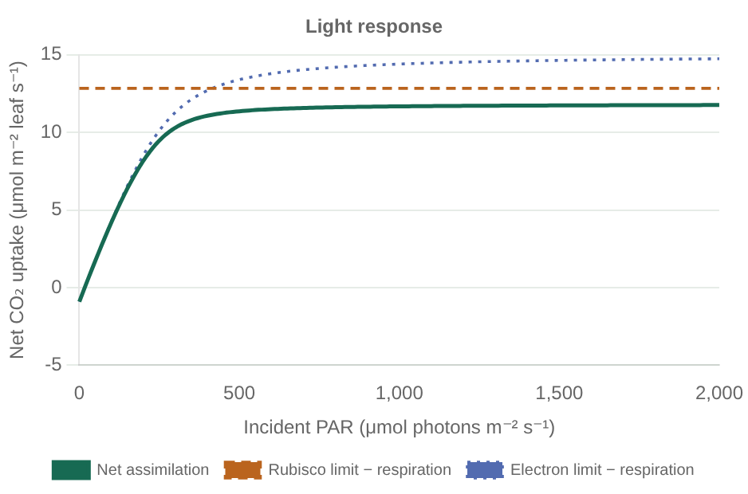
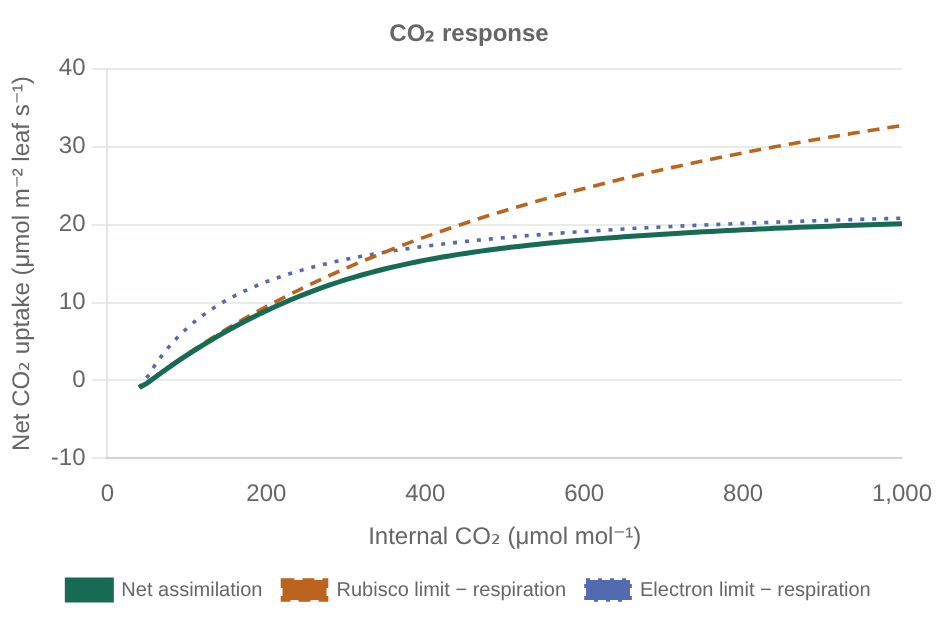
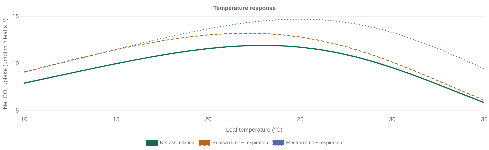

# Bonan examples within this package

Include only exercises solvable within leaf physiology. The reference is
[Bonan's supplemental programs](https://github.com/gbonan/bonanmodeling), inspected
at a10cf764013be58c2def1dbe7c7e52a3213e061e. Combined exercises will live in a separate
example repository later; they are not requirements to build a canopy or land model here.

| Program | Calculation | Status |
| --- | --- | --- |
| 11.1 | C3 responses to light, CO₂, and temperature at prescribed internal CO₂ | Three curves implemented and plotted in FP32/FP64; independent equation checks pass; upstream MATLAB output comparison pending |
| 12.1 | Leaf gas exchange at prescribed temperature, including light, CO₂, temperature, and vapor-pressure-deficit responses | Candidate; coupled C3 gas exchange is implemented, but exercise-specific treatments and reference comparison remain pending |

## Reproducing 11.1

Run `julia --project=. examples/bonan_11_1.jl` from the package root. Settings,
units, and provenance are in [the parameter file](../examples/parameters/bonan_11_1.toml).
The resulting CSV files provide the three response curves for both precisions.
The example calls production temperature, electron-transport, and carbon-assimilation
functions. Prescribed leaf temperature, internal CO₂, and light absorption are inputs;
it does not solve stomatal conductance, leaf energy balance, or canopy radiation.

Use incident PAR on the light-response x axis, internal CO₂ on the CO₂ axis, and
Celsius on the temperature axis. Upstream's CO₂ output stores atmospheric CO₂
while its plot label says Ci; our CSV stores both explicitly. PAR absorption is
applied once by the example, and prescribed Ci/Ca is visible in its configuration.
The example uses clipped sub-compensation rates to match upstream; the core also
provides a signed policy and minimum limitation as explicit alternatives.

### Response plots

These Float64 previews are exported from the [interactive Chart.js gallery](examples.html).
Open the gallery from a checkout to switch precision, inspect values, or download CSVs.
TOML reading and component assembly are separate from the response-curve script.

The dashed curves subtract respiration from each limiting rate. They share the net
assimilation units and are not gross carboxylation. Fixed inputs are listed in the
gallery and parameter file. [Regenerate figures and data](README.md#reproduce-the-plots).

## Why 12.1 fits, and what it needs

The reference prescribes leaf temperature; no canopy or leaf energy-balance solver
is needed. It couples biochemical demand to leaf boundary-layer transport and
stomatal regulation. Those are discrete leaf processes and can fit a small LeafModel.

A first implementation could target the reference's default C3 + Medlyn case.
The core now provides target laws, diffusion at prescribed conductance, and a converged
coupled equilibrium solver. 12.1 still needs its boundary-layer and vapor-pressure
treatments and reference validation. Prognostic conductance is a separate physical option;
using it does not reproduce a steady-state exercise automatically.
The reference also includes product limitation and alternative co-limitation choices;
these must be matched or any differences recorded. Full coverage additionally requires
C4 and the selectable Ball–Berry and water-use-efficiency optimization cases. Label
partial coverage explicitly instead of calling one model configuration full reproduction.

Keep the biochemical demand function independently callable. Place stomatal and
boundary-layer choices in concrete components; put the residual/convergence logic
at their composition boundary. Do not import canopy geometry, soils, or atmosphere
transport merely to run this exercise.

## Acceptance of an example

Use production components, explicit parameter files, declared units, and reference
provenance. Provide the intended curves and numerical comparisons with stated
FP32/FP64 tolerances, plus independent limiting-case checks. Students should be able
to inspect intermediate processes and replace implemented components through the API.
Add an example only when its required processes fit the package and are implemented.
The separate integration-example repository can later assemble other packages for
broader exercises and maintain any whole-book roadmap.
