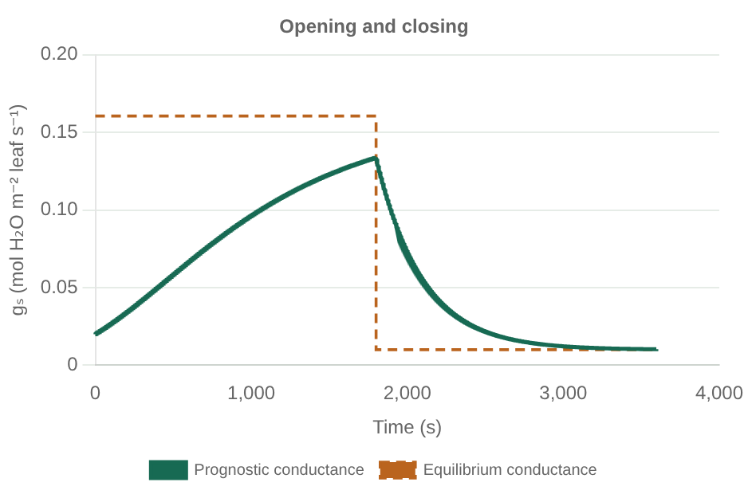
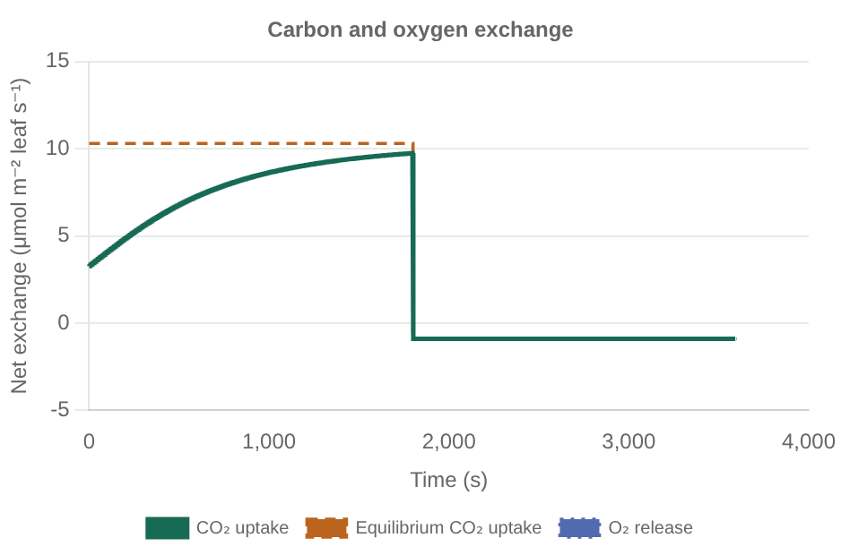

# Core leaf gas exchange

`LeafModel` holds three concrete components under `AbstractPhotosynthesis`,
`AbstractStomatalModel`, and `AbstractOxygenExchange`. State belongs to the caller.
Arrays, device selection, time integration, canopy transport, and soils are external.
See [the runnable example](../examples/core_exchange.jl) and its
[explicit settings](../examples/parameters/core_exchange.toml).

The short equilibrium script calls the production solver, oxygen budget, and
sensitivities. TOML parsing and parameter construction live in `examples/setup/`.
For time evolution, run [stomatal_response.jl](../examples/stomatal_response.jl).

## Worked light-to-dark example

These Float64 plots use the illustrative TOML settings: 1800 s in light followed
by 1800 s of darkness, opening/closing timescales of 600/300 s, and a 1 s Euler step.
Dashed equilibrium curves are fully coupled solves for each forcing interval;
they are distinct from the instantaneous target driving the prognostic tendency.
The state is continuous at the light switch; fluxes may change immediately.
Net O₂ and CO₂ overlap for the chosen core stoichiometry and respiratory quotient
of one, not as a general constraint on all leaves. Leaf temperature and humidity
are held fixed. This is not an observed time-course fit or a Bonan 12.1 reproduction.

Open the [interactive gallery](examples.html) locally for FP32/FP64 selection,
data inspection, and downloads. [Regeneration instructions](README.md#reproduce-the-plots).

## Stomatal targets and evolution

`BallBerry` and `Medlyn` implement `AbstractStomatalTarget`. Their inputs are net
assimilation, leaf-surface CO₂, pressure, and prescribed surface humidity or VPD.
Conductance is mol H₂O m⁻² leaf s⁻¹. The Medlyn slope uses Pa^½, not kPa^½.
Each law has an explicit minimum conductance; negative assimilation contributes
zero to its light-dependent opening term without clipping the carbon flux itself.

`SteadyStateStomata(target)` evaluates an instantaneous target. It does not by itself
solve the coupled equilibrium of assimilation, diffusion, and stomatal conductance.
Call `equilibrium_gas_exchange` for that closure, with an explicit `EquilibriumSolver`.
It uses safeguarded Newton or reference bisection and reports convergence, iterations,
and pressure/flux residuals. It supports minimum or quadratic limitation and signed
or clipped assimilation. See [equations and sensitivities](equilibrium_and_sensitivities.md).

`PrognosticStomata` exposes `(target - conductance) / timescale`. Opening and closing
timescales are independent parameters in seconds. This follows the first-order
framework in [Liu et al. (2024), Eq. 3](https://bg.copernicus.org/articles/21/1501/2024/).
The tendency does not advance or mutate `StomatalState`. The caller's integrator
must resolve the dynamics and target feedback; the example's Euler loop is illustrative.

`NoStomatalDynamics` skips target-law evaluation and returns zero tendency, retaining
the caller's prescribed conductance. It does not remove stomatal resistance.

## Analytical diffusion at known conductance

`SeriesDiffusion` specifies boundary-layer/mesophyll CO₂ conductances and the
H₂O/CO₂ stomatal diffusivity ratio. `gas_exchange` combines these resistances,
then solves the Rubisco and electron-limited supply–demand quadratics analytically.
Its supported biochemical choice is `MinimumLimitation` with `SignedAssimilation`.
Smooth co-limitation is supported in the iterative equilibrium solver, not silently
approximated by this analytical prescribed-conductance closure.

The reported CO₂ sites are distinct: leaf surface, intercellular space, and biochemical
site. Finite mesophyll resistance makes Ci different from Cc. The returned diffusion
residual compares supply and demand; tests also compare the analytic root with an
independent high-precision bracketed solution. Sub-compensation conditions retain
signed fluxes. Sealed leaves require CO₂ storage and are outside this quasi-steady
closure: supply strictly positive conductances.

`leaf_tendencies` assembles gas exchange, the current stomatal target/tendency, and
optional oxygen diagnostics. It implements the prescribed-conductance path needed
for prognostic stomata without an A–Ci fixed-point iteration. Humidity, VPD, leaf
temperature, and boundary-layer conductance are prescribed in this first core;
there is no humidity or energy-balance solve hidden inside it.

## Oxygen budget and explicit disabling

`CoreOxygenExchange` separates PSII gross production, photorespiratory uptake,
respiratory uptake, and net release. Its low-level input is actual linear electron
flow, Rubisco oxygenation, and respiratory CO₂ release. All fluxes are per leaf area;
net O₂ release is positive, whereas net CO₂ uptake is positive in photosynthesis.
The respiratory quotient is CO₂ released per O₂ consumed. Stoichiometric values
are explicit parameters; see [Gauthier et al. (2018)](https://pmc.ncbi.nlm.nih.gov/articles/PMC5933133/).

The C3 adapter assumes linear electron flow supplies carbon metabolism and
photorespiration only. It derives realized turnover from the limiting biochemical
capacity, not from potential electron transport. This retains nonzero gross fluxes
at the compensation point without dividing by a vanishing net assimilation rate.
For canonical stoichiometry and RQ=1, net O₂ release equals net CO₂ uptake; the tests
check this identity and the separate gross terms. Changing RQ changes that relation.

The adapter requires signed assimilation. A clipped sub-compensation curve cannot
provide the same carbon/oxygen budget. Gamma-star must match the prescribed O₂
level; a temperature response alone does not provide its oxygen dependence.
Alternative electron sinks, cyclic flow, oxygen-limited respiration, and internal O₂
transport/storage are outside this initial core.

`NoOxygenExchange` returns `nothing`, indicating an uncomputed diagnostic rather
than a physically zero flux. Dispatch omits the oxygen calculation entirely.
It is the default oxygen component; the user enables the budget explicitly.
