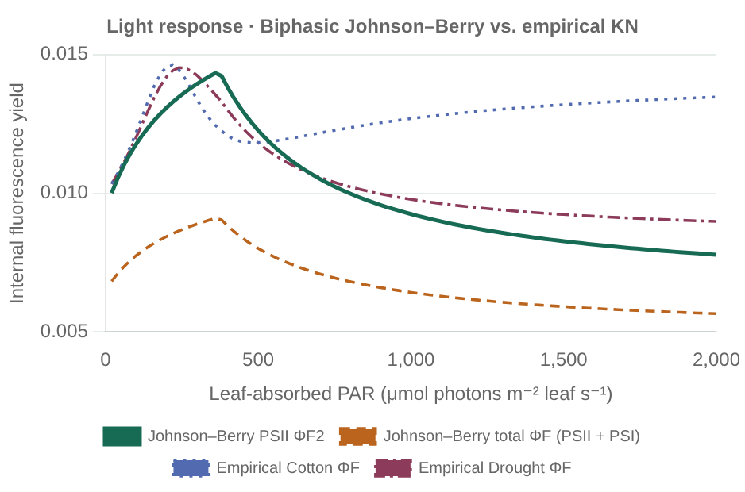
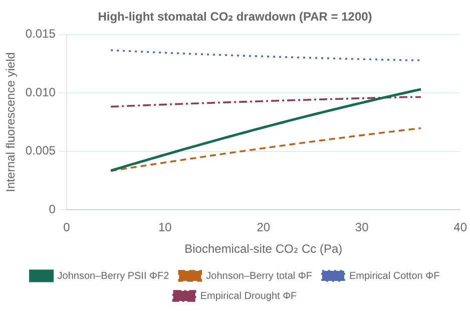
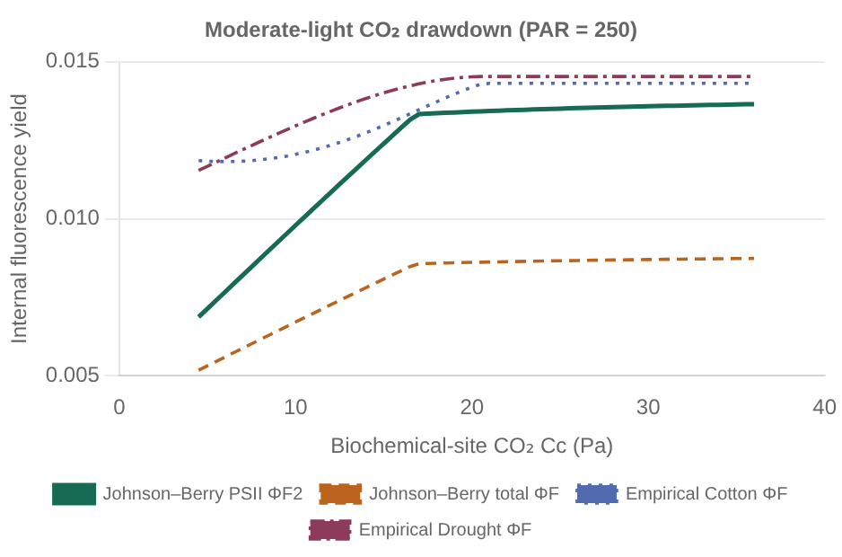
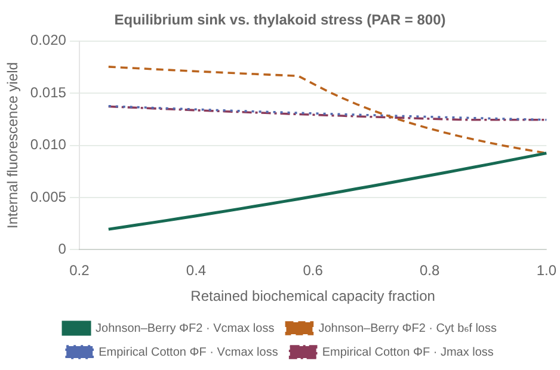
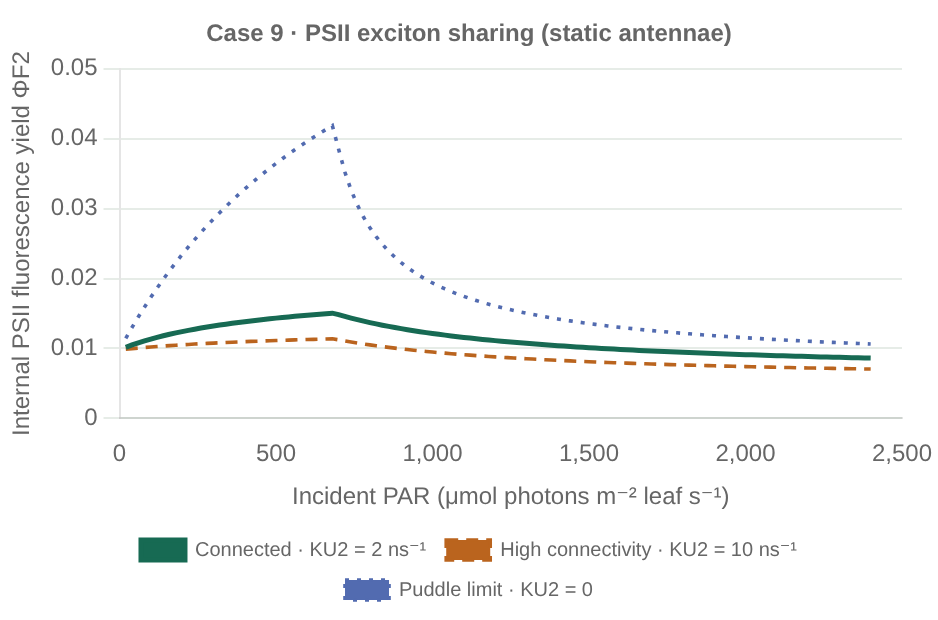
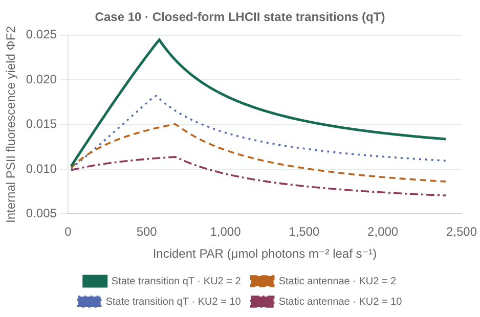
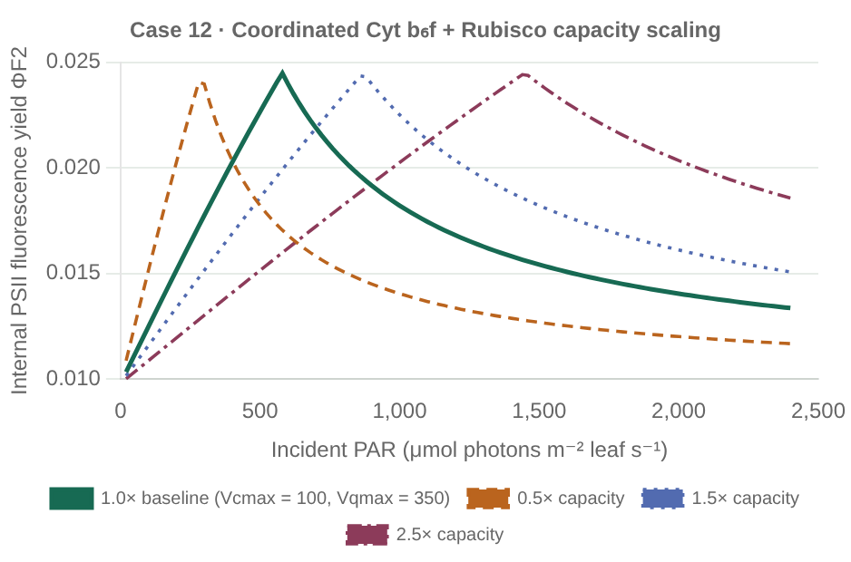
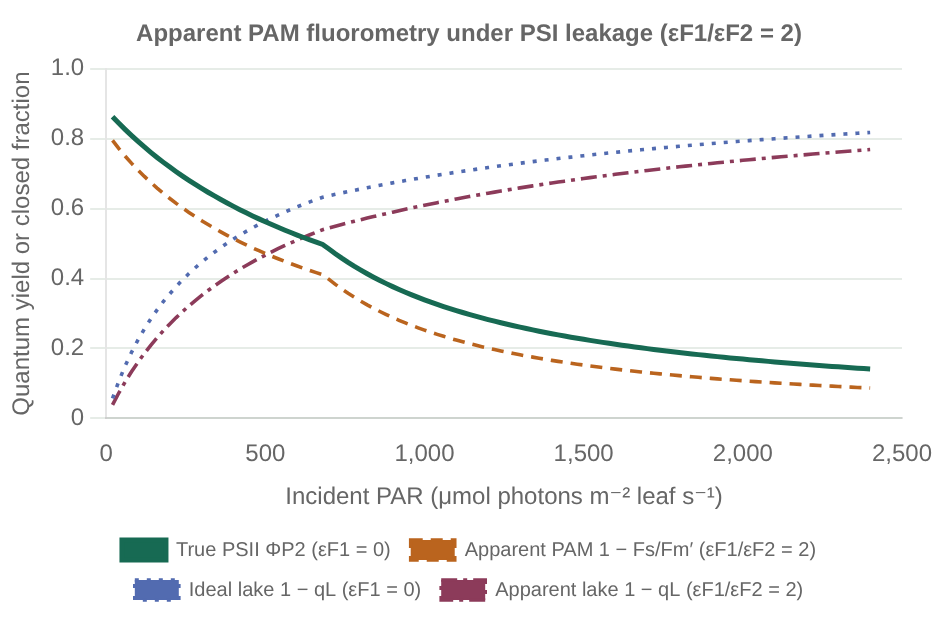

# Cytochrome $b_6f$ photosynthesis and coupled PSII/PSI stress fluorescence

[Run the comparison](../examples/cytochrome_stress.jl) or open the
[interactive offline gallery](examples.html#cytochrome-stress). Component assembly
lives in [setup/cytochrome_stress.jl](../examples/setup/cytochrome_stress.jl), and
all numerical values and literature citations are isolated in
[cytochrome_stress.toml](../examples/parameters/cytochrome_stress.toml).

This module implements the steady-state C3 Cytochrome $b_6f$ electron-transport and
coupled PSII/PSI fluorescence mechanics of Johnson & Berry (2021, *Photosynthesis
Research* 148:101–136, [doi:10.1007/s11120-021-00840-4](https://doi.org/10.1007/s11120-021-00840-4))
as composable, zero-allocation scalar components alongside the empirical PSII
rate-competition scheme of van der Tol et al. (2014,
[doi:10.1002/2014JG002713](https://doi.org/10.1002/2014JG002713)).

---

## 1. Biophysical structure of the coupled model

### Plastoquinol oxidation at Cytochrome $b_6f$ and PSII redox poise
Instead of an empirical $J_{\max}$, maximum electron transport is governed by
Cytochrome $b_6f$ active-site density $B_{6f}$ [`μmol sites m⁻² leaf`] and catalytic
turnover $k_q(T)$ [`mol e⁻ mol⁻¹ sites s⁻¹`]:

```math
V_{q\max}(T) = B_{6f}\,k_q(T).
```

Open PSI reaction centers operate with maximum quantum yield
$\Phi_{P1,\max} = K_{P1} / (K_{F1} + K_{D1} + K_{P1})$. First-order series kinetics
(`SerialLimitation`) between Cytochrome $b_6f$ and PSI excitation $Q_1$ determine
both available PSI electron supply and the steady-state fraction of open PSII
reaction centers $q_2$:

```math
J_{P700,\mathrm{avail}} = \frac{V_{q\max}\,\Phi_{P1,\max} Q_1}{V_{q\max} + \Phi_{P1,\max} Q_1},
\qquad
q_2 = 1 - \frac{J_{P700,\mathrm{avail}}}{V_{q\max}}
    = \frac{V_{q\max}}{V_{q\max} + \Phi_{P1,\max} Q_1}.
```

Evaluating $q_2$ directly as $V_{q\max} / (V_{q\max} + \Phi_{P1,\max} Q_1)$ preserves
full `Float32` precision at high irradiance without `1 - J/Vqmax` cancellation.

### Linear and cyclic electron transport from ATP/NADPH stoichiometry
Rubisco carboxylation ($V_c$) and oxygenation ($V_o$, with photorespiratory release
$R_p = 0.5 V_o = (\Gamma_*/C_c) V_c$) demand linear electrons $(4 C_c + 8\Gamma_*) V_c/C_c$
and ATP $(3 C_c + 7\Gamma_*) V_c/C_c$. Balancing linear photophosphorylation
($\eta_L$ ATP per $e^-$) and PSI cyclic electron flow ($\eta_C$ ATP per $e^-$) yields
the PSI-to-PSII electron ratio:

```math
\eta(C_c, \Gamma_*) = \frac{J_{P700}}{J_{P680}}
= 1 - \frac{\eta_L}{\eta_C} + \frac{1}{\eta_C}\,\frac{3 C_c + 7\Gamma_*}{4 C_c + 8\Gamma_*}.
```

Multiplying by $(4 C_c + 8\Gamma_*)$ produces a strictly linear denominator
$c_1 C_c + c_2 \Gamma_*$. For classical C3 coupling ($\eta_L = 0.75$, $\eta_C = 1.0$),
4 linear electrons supply all 3 ATP needed per carboxylation, whereas 8 linear
electrons supply only 6 of the 7 ATP needed per photorespiratory $\mathrm{CO_2}$
release—requiring exactly 1 cyclic PSI turnover and shifting the denominator from
$4 C_c + 8\Gamma_*$ to **$4 C_c + 9\Gamma_*$**. Because this preserves the exact
hyperbolic $M / (C_c + K)$ form in $C_c$, closed-form analytical `gas_exchange`,
exact `carbon_assimilation_derivative`, `SafeguardedNewton` `equilibrium_gas_exchange`,
`assimilation_sensitivity`, and water-splitting `oxygen_exchange` all work seamlessly.

### Connected-units PSII feedback quenching and PSI donor-side quenching
Given realized linear flow $\Phi_{P2} = J_{P680} / Q_2$ and open fraction $q_2$,
`CytochromeFluorescence` solves the connected-units ($K_{U2} \ge 0$) quadratic
directly for dynamic energy-dependent quenching $K_N \ge 0$ without `S_1 - S_base`
cancellation. Because $K_{F2}$, $K_{D2}$, $K_{N,\mathrm{sus}}$, and $K_N$ act equally
in open and closed PSII units, non-photochemical excitons branch strictly in
proportion to their rate constants even when $K_{U2} > 0$, and internal PSII
Stern–Volmer quenching satisfies $\mathrm{NPQ} = (K_N + K_{N,\mathrm{sus}}) / (K_{F2} + K_{D2})$.

For PSI, oxidized $\mathrm{P700^+}$ quenches closed centers radiationlessly at rate
$K_{X1}$. When $K_{X1} = K_{P1}$ (`14.5 ns⁻¹`), $\Phi_{F1} = K_{F1}/(K_{F1}+K_{D1}+K_{P1}) \approx 0.00331$
is invariant to PSI redox state, providing a physical far-red baseline.

### Avoiding negative-$K_N$ parameterizations (`minimum_psii_partition`)
Under `SerialLimitation()` and `BroadbandExcitation()`, across all $C_c \ge 0$,
$V_{q\max} > 0$, and $Q_{\mathrm{abs}} > 0$, $K_N \ge 0$ requires broadband PSII
excitation fraction $\beta$ to satisfy:

```math
\beta \ge \beta_{\min} = \frac{\Phi_{P1,\max}}{\Phi_{P1,\max} + \eta_{\min}\,\Phi_{P2,\max}(1)}.
```

For Johnson & Berry (2021) Table 1 rates ($\Phi_{P1,\max} = 14.5/15.1$,
$\Phi_{P2,\max}(1) = 4.5/5.1$, $\eta_{\min} = 1$), $\beta_{\min} \approx 0.52114$.
Setting $\beta = 0.50$ causes $\Phi_{P2}(Q \to 0^+) = 0.9603 > 0.8824$, silently
forcing unphysical negative $K_N$ in unchecked implementations. Here,
`validate_fluorescence_coupling` enforces `SerialLimitation()`, $\eta_{\min} \ge 1$,
and $\beta \ge \beta_{\min}$ at setup, while `fluorescence` rejects any runtime
$\Phi_{P2} > \Phi_{P2,\max}(q_2) + \text{tol}$ (such as far-red canopy shade under
`PrescribedDualExcitation` where $Q_2/(Q_1 + Q_2) < \beta_{\min}$) with
`FluorescenceIncompatibleRates`.

---

## 2. Why mechanistic and empirical SIF yields diverge under stress

In [cytochrome_stress.jl](../examples/cytochrome_stress.jl), both models share
identical Rubisco kinetics ($V_{c\max,25} = 60\;\mu\mathrm{mol\;m^{-2}\;s^{-1}}$,
$K_c$, $K_o$, $\Gamma_*$, $R_d$) and identical Rubisco-saturated assimilation
($A_n = 13.33\;\mu\mathrm{mol\;m^{-2}\;s^{-1}}$ at `PAR >= 1200`, `Cc = 28 Pa`).
Because `SerialLimitation` ($\theta = 0$ rectangular hyperbola) bends more gradually
than FvCB's empirical non-rectangular hyperbola ($J_{\max,25} = 100.2\;\mu\mathrm{mol\;e^-\;m^{-2}\;s^{-1}}$,
$\theta_J = 0.90$ from `bonan_11_1.toml`), the Cytochrome benchmark uses
$B_{6f} = 0.65\;\mu\mathrm{mol\;m^{-2}}$ ($V_{q\max,25} = 195\;\mu\mathrm{mol\;e^-\;m^{-2}\;s^{-1}}$)
so both models cross from electron-transport to Rubisco limitation in the same
mid-irradiance range (`PAR ≈ 450–550 μmol m⁻² s⁻¹`):

1. **Light sweep (`PAR = 0 → 2000 μmol m⁻² s⁻¹`, `Cc = 28 Pa`):** Johnson–Berry
   $\Phi_{F2}$ exhibits the observed biphasic rise-and-fall—increasing at low light as
   plastoquinone reduces ($q_2$ decreases), peaking at the $A_j \to A_c$ transition,
   and declining at high light as lumen feedback $\mathrm{NPQ}$ builds. Empirical
   Cotton $K_N(x)$ saturates near $K_{N0} = 2.48$ and turns upward at high light.
2. **High-light stomatal closure (`PAR = 1200`, `Cc: 36 → 4.5 Pa`):** Because Cotton
   $K_N(x)$ is already saturated at high light, stomatal $\mathrm{CO_2}$ drawdown
   increases $(1 - \Phi_P)$ without additional quenching—predicting a **+7% fluorescence
   yield increase** (wrong sign) unless manually switched to a separate empirical
   Drought $K_N(x)$ table (`-8.5%`, capped at $K_{N0} = 5.01$). Johnson–Berry's single
   unchanged parameter set surges $\mathrm{NPQ}$ (`5.8 → 22.2`) and reduces $\Phi_{F2}$
   by **67%** (total $\Phi_F$ by **52%**). Note that because JB2021's steady-state
   inversion lacks an upper PsbS/zeaxanthin saturation cap or alternative electron
   sinks (Mehler/malate valve), `NPQ = 22.2` at extreme $C_c = 4.5\;\mathrm{Pa}$
   exceeds typical physiological C3 `NPQ` ceilings (`~3–8`).
3. **Moderate-light $\mathrm{CO_2}$ drawdown (`PAR = 250`):** Above the $A_c/A_j$
   crossover, FvCB + empirical $K_N(x)$ is completely flat vs. $C_c$, whereas
   Johnson–Berry responds smoothly via photorespiratory PSI cyclic electron flow ($\eta$).
4. **Coupled Medlyn equilibrium—Rubisco sink loss vs. Cytochrome $b_6f$ loss (`PAR = 800`):**
   Downregulating capacity from `100%` to `25%` reveals **opposite signs** in
   Johnson–Berry: Rubisco $V_{c\max}$ loss plunges $\Phi_{F2}$ by **79%** (open PSII
   traps + strong feedback $K_N$), whereas Cytochrome $b_6f$ loss raises $\Phi_{F2}$
   by **89%** (reduced PQ pool closes $q_2$ and relaxes $K_N$). Empirical $K_N(x)$
   depends solely on $\Phi_P$ and conflates both stresses.









---

## 3. State transitions, capacity scaling, and apparent PAM fluorometry

The benchmark script [johnson_berry_2021.jl](../examples/johnson_berry_2021.jl)
([setup/johnson_berry_2021.jl](../examples/setup/johnson_berry_2021.jl),
[johnson_berry_2021.toml](../examples/parameters/johnson_berry_2021.toml)) reproduces
four additional mechanisms from Johnson & Berry (2021, Table 2, Fig. 8 Cases 9, 10, 12,
and Eqs. 38–42):

1. **Closed-form pointwise state transitions (`StateTransitionRule`, `state_transition_excitation`):**
   Setting dynamic quenching $K_N = 0$ under Cytochrome $b_6f$ limitation reduces the
   connected-units PSII photochemical yield to
   $\Phi_{P2}^{(0)}(q_2) = q_2 K_{P2}(K_0 + K_{U2}) / [K_0(K_{P2} + K_0 + K_{U2}) + q_2 K_{P2} K_{U2}]$
   with $K_0 = K_{F2} + K_{D2} + K_{N,\mathrm{sus}}$. Substituting
   $q_2 = V_{q\max} / (V_{q\max} + \Phi_{P1,\max}(1 - \beta) Q_{\mathrm{abs}})$ into
   $J_{P700,j} = \eta \beta Q_{\mathrm{abs}} \Phi_{P2}^{(0)}(q_2)$ cancels $Q_{\mathrm{abs}} q_2 > 0$
   and yields a scale-normalized closed-form quadratic for $\alpha_1 = 1 - \beta$. At and
   above the Rubisco saturation crossover ($J_{P700,j} \ge J_{P700,c}$, where
   $q_{2,\mathrm{sat}} = \max(V_{q\max} - J_{P700,c}, 0)/V_{q\max}$), $\beta$ freezes at
   $\beta_{\mathrm{sat}}$—evaluating locally at each `LeafEnvironment` with **zero iteration
   and zero array scans**, and splitting $Q_{\mathrm{abs}}$ via Sterbenz's Lemma so
   $Q_2 + Q_1 \equiv Q_{\mathrm{abs}}$ identically across all IEEE-754 binades. When
   $K_{U2} = 0$ (puddle limit), $\beta_{\mathrm{opt}}$ is independent of $Q_{\mathrm{abs}}$ (`0%`
   excursion); for $K_{U2} = 2$ and $10\;\mathrm{ns^{-1}}$, LHCII migration reduces $\beta$
   by `17.1%` and `21.8%` across the light-limited regime (`Case 10`)—avoiding the
   low-light $K_N > 0$ required when connected antennae have static cross-sections
   (`Case 9`), boosting light-limited assimilation, and producing an intermediate
   biphasic $\Phi_{F2}$ peak between the static connected curves and the $K_{U2} = 0$
   spike.
2. **Coordinated photosynthetic capacity inversion (`Case 12`, Fig. 8o):**
   Scaling Cytochrome $b_6f$ ($B_{6f}$) and Rubisco ($V_{c\max}$, $R_d$) coordinately
   (`0.5×` to `2.5×`) flips the sign of $\partial \Phi_{F2} / \partial \mathrm{capacity}$
   between low light (where higher capacity keeps PQ oxidized and lowers $\Phi_{F2}$) and
   high light (where higher sink capacity relieves feedback $K_N$ and raises $\Phi_{F2}$).
3. **Apparent PAM fluorometry and PSI detector leakage (`PAMFluorescenceObserver`, `pam_fluorescence`):**
   Long-pass (`>700 nm`) leaf-chamber PAM fluorometers weight PSI emission more heavily
   than PSII ($\varepsilon_{F1}/\varepsilon_{F2} \approx 2.0$, where PSI contributes
   `~39%` of dark $F_o$ and `~7%` of $F_m$). Using overflow- and cancellation-free
   difference identities, `pam_fluorescence` maps internal yields to apparent Genty
   $1 - F_s/F_m'$, Hendrickson yields, apparent $\mathrm{NPQ}$, puddle $q_P$, and lake
   $q_L$. When $K_{X1} = K_{P1}$ and cross-sections are static, PSI contributes an
   identical background to $F_m'$, $F_o'$, and $F_s$, leaving $q_P = (F_m' - F_s)/(F_m' - F_o')$
   **exact-invariant** to $\varepsilon_{F1}$ while systematically depressing apparent
   $1 - F_s/F_m'$, $1 - q_L$, and $\mathrm{NPQ}_{\mathrm{app}}$. See the
   [Flexas et al. (2002) water-stress benchmark](flexas_2002_water_stress.md) for a direct
   application of `PAMFluorescenceObserver` ($\varepsilon_{F1}/\varepsilon_{F2} = 2.0$)
   to observed grapevine $F_s / F_o$ drought curves.









---

## 4. Scope limits

- Internal photon fluxes (`psii_photon_flux`, `psi_photon_flux`, `total_photon_flux`)
  represent emission **before** within-leaf chlorophyll reabsorption, escape
  probabilities, and PSII/PSI spectral shaping (`CanopyOptics.jl`). Within-leaf
  chlorophyll reabsorption attenuates ~685 nm PSII fluorescence much more strongly
  than >710 nm PSI emission, increasing PSI's fractional contribution to escaped
  far-red SIF relative to pre-escape `total_fluorescence_yield`.
- Quenching is steady-state feedback $K_N$ without an empirical upper PsbS/zeaxanthin
  ceiling or slow induction/relaxation memory. Lit states with zero biochemical
  turnover (`Vcmax = 0` where $K_N \to \infty$, or `Vqmax = 0` where $q_2 = \Phi_{P2} = 0$
  is indeterminate) and PSII-starved far-red shade ($Q_2/(Q_1 + Q_2) < \beta_{\min}$)
  lie outside the steady-state $K_N \ge 0$ inversion domain and return
  `FluorescenceIncompatibleRates`.
- Yields close per-photosystem photon excitation budgets ($\sum \Phi = 1$), not leaf
  sensible/latent/radiative joule budgets.
