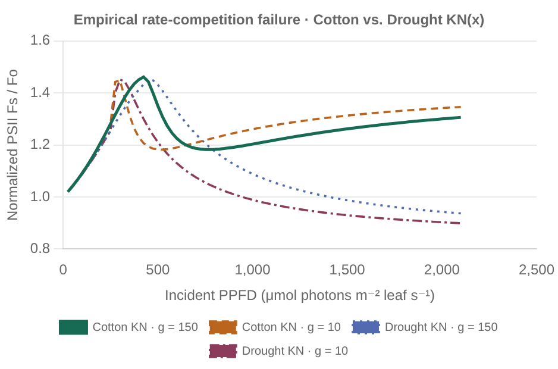
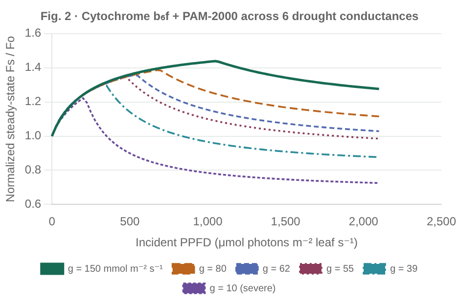
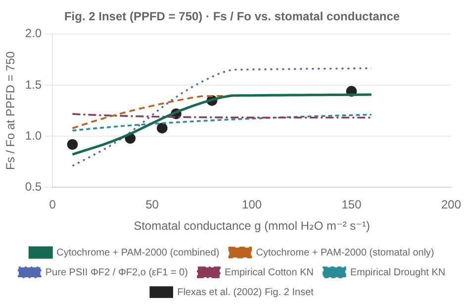
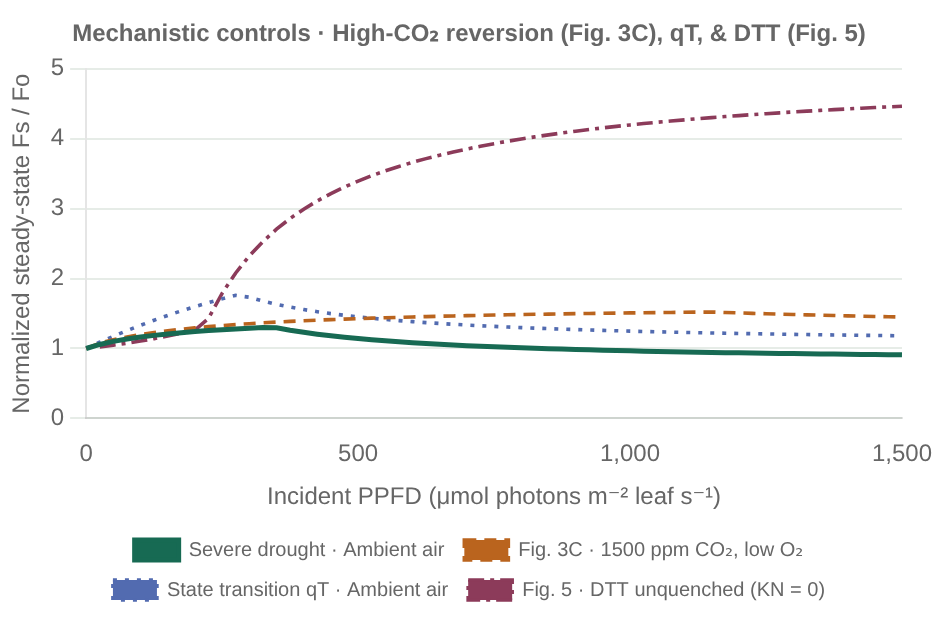

# Water-stress steady-state fluorescence ($F_s / F_o$): Flexas et al. (2002) benchmark

[Run the benchmark](../examples/flexas_2002.jl) or explore all four panels in the
[interactive offline gallery](examples.html#flexas-2002). Model assembly lives in
[setup/flexas_2002.jl](../examples/setup/flexas_2002.jl), and every grapevine parameter,
unit, and digitized observation is isolated in
[flexas_2002.toml](../examples/parameters/flexas_2002.toml).

Flexas et al. (2002, *Physiologia Plantarum* 114:231–240,
[doi:10.1034/j.1399-3054.2002.1140209.x](https://doi.org/10.1034/j.1399-3054.2002.1140209.x))
measured simultaneous gas exchange (LI-6400) and steady-state chlorophyll fluorescence
(Walz PAM-2000, $>700\;\mathrm{nm}$ long-pass detector) on *Vitis vinifera* L. cv.
Tempranillo at $25\;^\circ\mathrm{C}$ (`298.15 K`) and $50\%$ relative humidity across
six progressive drought stages indexed by maximum daily stomatal conductance to water
vapor, $g_{sw} \in \{150, 80, 62, 55, 39, 10\}\;\mathrm{mmol\;H_2O\;m^{-2}\;s^{-1}}$.
Normalizing steady-state fluorescence $F_s$ by dark-adapted basal fluorescence $F_o$
eliminates leaf-to-leaf variation in chlorophyll content and sensor geometry, exposing
three diagnostic features in Figure 2:

1. **Peak suppression:** maximum $F_s / F_o$ declines monotonically from `~1.44` in
   well-watered vines ($g_{sw} = 150$) to `~1.12` under severe drought ($g_{sw} = 10$).
2. **Leftward irradiance shift:** the photosynthetic photon flux density (`PPFD`) at
   which $F_s / F_o$ peaks shifts from `~750–1000 μmol photons m⁻² s⁻¹` down to
   `~100–200 μmol photons m⁻² s⁻¹`.
3. **Sub-$F_o$ high-light quenching & curvilinear conductance inset:** under severe
   drought ($g_{sw} \le 39$), non-photochemical quenching pulls high-irradiance $F_s$
   below dark $F_o$ ($F_s / F_o < 1.0$), producing a positive curvilinear $F_s / F_o$
   vs. $g_{sw}$ relationship at $\mathrm{PPFD} = 750\;\mu\mathrm{mol\;m^{-2}\;s^{-1}}$
   (Figure 2 Inset).

Evaluating every steady-state fluorescence formulation in `LeafPhotosynthesis.jl`
against these experiments separates structural mathematical constraints from parameter
calibration.

---

## 1. Why single-variable empirical $K_N(x)$ fits fail on Figure 2

In `RateCompetitionFluorescence` paired with `SaturationQuenching` (van der Tol et al.
2014, *JGR Biogeosciences* 119:2312–2327, Eq. 19), energy-dependent non-photochemical
quenching $K_N(x)$ is parameterized solely as a Hill function of relative PSII light
saturation $x = 1 - \Phi_P / \Phi_{P0} \in [0, 1]$, where
$\Phi_{P0} = K_P / (K_F + K_D + K_P)$ is dark-adapted maximum PSII photochemical yield:

```math
K_N(x) = K_{N0}\,\frac{(1 + b)\,x^a}{b + x^a},
\qquad
\frac{\Phi_F(x)}{\Phi_{F,o}}
= \frac{1 - \Phi_{P0}(1 - x)}{(1 - \Phi_{P0})\left[1 + \dfrac{K_N(x)}{K_F + K_D}\right]}.
```

Because $\Phi_F / \Phi_{F,o}$ is a single-variable function $f(x)$ with no independent
dependence on plastoquinone redox state or stromal sink capacity, **any** irradiance
sweep from darkness ($x = 0$) to strong Rubisco limitation ($x \to x_{\max}$ near $1$)
maps `PPFD` through the exact same scalar curve $f(x)$:

- **Peak-height invariance across drought:** changing $g_{sw}$ or $V_{c\max}$ rescales
  the horizontal coordinate $x(\mathrm{PPFD})$ (shifting where $x^*$ occurs along the
  `PPFD` axis), but reaches the **identical global peak**
  $\max_{x} f(x) = f(x^*)$ at every conductance—`1.461` (at $x^* \approx 0.19$,
  $\mathrm{PPFD} \approx 425\;\mu\mathrm{mol\;m^{-2}\;s^{-1}}$ for $g_{sw} = 150$) for
  the Cotton parameter set ($K_{N0} = 2.48$, $a = 2.83$, $b = 0.114$) and `1.451` (at
  $x^* \approx 0.23$, $\mathrm{PPFD} \approx 450\;\mu\mathrm{mol\;m^{-2}\;s^{-1}}$ for
  $g_{sw} = 150$) for the Flexas Drought parameter set ($K_{N0} = 5.01$, $a = 1.93$,
  $b = 10.0$). Single-variable $K_N(x)$ models therefore cannot reproduce the progressive
  `1.44 → 1.12` peak suppression in Figure 2.
- **High-light sign inversion in Cotton $K_N(x)$:** because Cotton $b = 0.114$ saturates
  $K_N(x)$ near $K_{N0} = 2.48$ by $x \approx 0.80$, further increases in $x$ increase
  the numerator $1 - \Phi_{P0}(1 - x)$ faster than the denominator, turning
  $\Phi_F / \Phi_{F,o}$ **upward** at high light and predicting **higher** $F_s / F_o$
  under severe drought than under well-watered conditions (`1.22` at $g_{sw} = 10$ vs.
  `1.18` at $g_{sw} = 150$ at $\mathrm{PPFD} = 750$, and `1.35` vs. `1.31` at
  $\mathrm{PPFD} = 2100$—opposite in sign to the Figure 2 Inset). Switching to the
  empirical Drought fit ($K_{N0} = 5.01, b = 10.0$, which van der Tol et al. 2014 fitted
  directly to Flexas et al. 2002) restores sub-$F_o$ quenching at high irradiance (`0.90`
  at $\mathrm{PPFD} = 2100$), yet still leaves peak height fixed near `1.45` across all
  conductances.



---

## 2. Two-state Cytochrome $b_6f$ mechanics and Walz PAM-2000 PSI leakage

`CytochromePhotosynthesis` + `CytochromeFluorescence` (Johnson & Berry 2021,
*Photosynthesis Research* 148:101–136) resolves both limitations by separating two
distinct physical state variables:

1. **Thylakoid electron-supply poise $q_2(Q_1, V_{q\max})$:** open PSII trap fraction
   $q_2 = V_{q\max} / (V_{q\max} + \Phi_{P1,\max} Q_1)$ is governed by absorbed PSI
   excitation $Q_1$ and Cytochrome $b_6f$ plastoquinol oxidation capacity $V_{q\max}$,
   independent of stromal $\mathrm{CO_2}$. At low irradiance, carbon assimilation is
   light-limited ($J_{P700,j} \le J_{P700,c}$), dynamic feedback quenching $K_N$ remains
   near zero, and progressive reduction of the plastoquinone pool ($q_2$ decreasing with
   `PPFD`) drives the initial rise in $F_s / F_o$.
2. **Stromal sink saturation $\Phi_{P2}(Q_2, C_c, V_{c\max})$:** once absorbed light
   exceeds the Rubisco + photorespiratory ceiling $J_{P700,c}(C_c, \Gamma_*, V_{c\max})$,
   realized linear electron yield $\Phi_{P2} = J_{P680} / Q_2$ falls below the
   unquenched connected-units envelope $\Phi_{P2}^{(0)}(q_2)$. Closing the PSII exciton
   budget induces lumen-pH feedback quenching $K_N > 0$, truncating the $q_2$-driven
   fluorescence rise right at the $A_j \to A_c$ transition. Lowering $g_{sw}$ draws down
   chloroplast $C_c$, lowering $J_{P700,c}$ so the $A_j = A_c$ crossover occurs at lower
   `PPFD` where $q_2$ is still largely open—simultaneously **lowering peak $F_s / F_o$**,
   **shifting peak `PPFD` leftward**, and driving high-light $F_s / F_o < 1.0$.

### Apparent PAM fluorometry (`PAMFluorescenceObserver`)

Flexas et al. (2002) recorded $F_s / F_o$ with a Walz PAM-2000 (`>700 nm` long-pass
filter), which weights far-red PSI emission roughly twice as strongly as PSII emission
($\varepsilon_{F1} / \varepsilon_{F2} = 2.0$; Johnson & Berry 2021, Eqs. 38–42):

```math
\frac{F_s}{F_o}
= \frac{\varepsilon_{F2}\,\alpha_2\,\Phi_{F2} + \varepsilon_{F1}\,\alpha_1\,\Phi_{F1}}
       {\varepsilon_{F2}\,\alpha_{2,\mathrm{dark}}\,\Phi_{F2,o} + \varepsilon_{F1}\,\alpha_{1,\mathrm{dark}}\,\Phi_{F1,o}}.
```

Because oxidized $\mathrm{P700^+}$ quenches closed PSI reaction centers at the same rate
as open photochemistry ($K_{X1} = K_{P1} = 14.5\;\mathrm{ns^{-1}}$), PSI contributes a
redox-invariant baseline ($\sim 39\%$ of dark $F_o$). With zero tuning of Johnson &
Berry's Table 1 decay rates or $\varepsilon_{F1}/\varepsilon_{F2} = 2.0$,
`dark_pam_levels` predicts dark-adapted apparent $F_v / F_m = \mathbf{0.821}$—squarely
inside Flexas et al. (2002, p. 234) measured **`0.80–0.83`**—whereas pure PSII emission
($\varepsilon_{F1} = 0$) has $F_v / F_m = 0.882$ and over-predicts well-watered
$F_s / F_o$ (`1.66` at $\mathrm{PPFD} = 750$ vs. observed `1.44`).



---

## 3. Photorespiratory electron-sink floor and non-stomatal drought transition

Separating pure stomatal diffusion (`enable_nonstomatal = false`, fixed $V_{c\max}$ and
$B_{6f}$) from coordinated stomatal + biochemical downregulation (`enable_nonstomatal = true`)
in the Figure 2 Inset ($\mathrm{PPFD} = 750\;\mu\mathrm{mol\;m^{-2}\;s^{-1}}$) reveals a
fundamental C3 stoichiometric boundary. In ambient air ($O = 21\;\mathrm{kPa}$,
$\Gamma_* = 3.70\;\mathrm{Pa}$), even at the photorespiratory $\mathrm{CO_2}$
compensation point ($C_c = \Gamma_*$), gross Rubisco carboxylation $V_c(\Gamma_*)$ and
photorespiratory $\mathrm{CO_2}$ release $0.5\,V_o(\Gamma_*) = V_c(\Gamma_*)$ cancel in
net carbon uptake while **both** carboxylation ($c_1\Gamma_* = 4\Gamma_*$) and
photorespiration + PSI cyclic flow ($c_2\Gamma_* = 9\Gamma_*$, giving
$\eta(\Gamma_*) = 13/12 \approx 1.083$ for $\eta_L = 0.75$, $\eta_C = 1.0$) continue
consuming electrons:

```math
\lim_{C_c \to \Gamma_*} J_{P700,c}(C_c)
= \frac{13\,\Gamma_*\,V_{c\max}}{\Gamma_* + K_c(1 + O / K_o)}
\approx 0.799\,V_{c\max}.
```

- **Mild-to-moderate drought ($g_{sw} \ge 62\;\mathrm{mmol\;m^{-2}\;s^{-1}}$):** pure
  stomatal $\mathrm{CO_2}$ drawdown quantitatively tracks both Figure 2 and the Figure 2
  Inset (`1.41 → 1.37 → 1.30` vs. observed `1.44 → 1.35 → 1.22`).
- **Severe drought ($g_{sw} < 60\;\mathrm{mmol\;m^{-2}\;s^{-1}}$):** pure stomatal
  closure hits the photorespiratory sink floor ($J_{P700,c} \ge 76.7\;\mu\mathrm{mol\;e^-\;m^{-2}\;s^{-1}}$
  at $C_c = \Gamma_*$ for $V_{c\max} = 96$, and $\approx 79.3\;\mu\mathrm{mol\;e^-\;m^{-2}\;s^{-1}}$
  as $g_{sw} \to 0$ where day respiration $R_d = 0.80$ holds $C_c \approx 4.21\;\mathrm{Pa} > \Gamma_*$),
  preventing the Figure 2 peak from shifting below `~350–400 μmol m⁻² s⁻¹` or
  $F_s / F_o(750)$ from dropping below `~1.08`. Reproducing peaks at `200 μmol m⁻² s⁻¹`
  and sub-$F_o$ high-light $F_s / F_o(750) = 0.82\text{–}1.02$ (`0.73–0.88` at
  $\mathrm{PPFD} = 2100$) requires the non-stomatal biochemical downregulation
  documented in *Vitis vinifera* when prolonged drought reduces $g_{sw}$ below
  `80–100 mmol m⁻² s⁻¹` (Escalona et al. 1999; Flexas et al. 2002, Fig. 3A & p. 239,
  modeled via a smooth Hill transition retaining `60%` $V_{c\max}$ and `85%` $B_{6f}$ as
  $g_{sw} \to 0$).



---

## 4. Physiological controls: high-$\mathrm{CO_2}$ reversion, `qT` state transitions, and DTT

The fourth benchmark panel tests three experimental perturbations at severe water stress
($g_{sw} = 39\;\mathrm{mmol\;H_2O\;m^{-2}\;s^{-1}}$):

1. **High-$\mathrm{CO_2}$ / $\mathrm{O_2}$-depleted reversion (Flexas et al. 2002, Fig. 3C):**
   switching ambient air ($37\;\mathrm{Pa}\;\mathrm{CO_2}$, $21\;\mathrm{kPa}\;\mathrm{O_2}$)
   to $152\;\mathrm{Pa}\;\mathrm{CO_2}$ (`1500 ppm`) in $\mathrm{N_2}$ balance
   ($200\;\mathrm{Pa}\;\mathrm{O_2}$) bypasses stomatal diffusion limitation, restores
   carboxylation ($A_n \approx 15.8\;\mu\mathrm{mol\;m^{-2}\;s^{-1}}$ at $g_{sw} = 39$
   and $12.7\;\mu\mathrm{mol\;m^{-2}\;s^{-1}}$ at $g_{sw} = 10$, matching Fig. 3A's
   `~12.5`), relieves feedback $K_N$, and restores $F_s / F_o$ to `1.45–1.52` across
   high irradiance—confirming that the severe-drought $F_s / F_o < 1.0$ depression is
   driven primarily by stromal electron-sink restriction rather than irreversible PSII
   photoinhibition.
2. **Closed-form LHCII state transitions (`StateTransitionRule`, `qT`):** in a static
   connected antenna ($K_{U2} = 2\;\mathrm{ns^{-1}}$), exciton sharing boosts PSII
   efficiency as traps close and induces small positive feedback $K_N > 0$ even in the
   Cytochrome-limited low-light regime (`Case 9`), damping the low-light $F_s / F_o$
   rise (`1.30`). Allowing `StateTransitionRule` (`Case 10`) to migrate LHCII from PSII
   to PSI ($\beta: 0.516 \to 0.414$) maintains $K_N = 0$ up to Rubisco saturation while
   increasing PSI emission (weighted `2×` by the `>700 nm` PAM-2000 detector), raising
   the low-light apparent $F_s / F_o$ peak to `1.76` before decaying under high-light
   feedback $K_N$ (`1.18` at $\mathrm{PPFD} = 1500$). Because Flexas et al. (2002)
   observed a damped peak (`~1.15`) rather than an unquenched `1.76` spike at
   $g_{sw} = 39$, water-stressed grapevine leaves operate much closer to static antenna
   partitioning than full $K_N = 0$ state-transition rebalancing.
3. **DTT xanthophyll-cycle inhibition (Flexas et al. 2002, Fig. 5):** evaluating
   `RateCompetitionFluorescence` with `ConstantQuenching(0)` ($K_N = 0$) removes
   energy-dependent thermal dissipation, causing $F_s / F_o$ to climb monotonically past
   `2.3–4.5` as traps close—matching dithiothreitol-infiltrated leaves in Figure 5.



---

## 5. Summary across SIF / fluorescence yield formulations

| Formulation in `LeafPhotosynthesis.jl` | Dark $F_v / F_m$ | Peak $F_s / F_o$ suppression vs. $g_{sw}$ | Leftward peak `PPFD` shift | High-light $F_s / F_o < 1$ under severe drought | Fig. 2 Inset sign ($\partial(F_s/F_o)/\partial g_{sw}$ at `PPFD = 750`) |
| --- | --- | --- | --- | --- | --- |
| `ConstantQuenching(0)` (DTT / $K_N = 0$) | `0.800` | None (climbs to `4.47`) | None (no peak) | No | Negative (matches DTT-infiltrated leaves only, Fig. 5) |
| `SaturationQuenching` — Cotton $K_N(x)$ | `0.800` | **No** (invariant `1.45–1.46`) | Yes (`425 → 300`) | No (`1.31–1.35` at `2100`) | **Negative** (`1.22 → 1.18`, inverted drought sign) |
| `SaturationQuenching` — Drought $K_N(x)$ | `0.800` | **No** (invariant `1.45`) | Yes (`450 → 300`) | Yes (`0.90` at `2100`) | Positive (`1.06 → 1.21`, empirical fit to Flexas) |
| `CytochromeFluorescence` (pure PSII, $\varepsilon_{F1}=0$) | `0.882` | **Yes** | **Yes** | Yes (`0.71` at `750`) | Positive (`0.71 → 1.66`), over-amplifies well-watered $F_s/F_o$ |
| `CytochromeFluorescence` + `PAMFluorescenceObserver` ($\varepsilon_{F1}/\varepsilon_{F2}=2.0$, stomatal only) | **`0.821`** | Partial (`1.44 → 1.32`, floor at $\Gamma_*$) | Partial (floor `~375`) | Floor `~1.00` | Positive above $g_{sw} \ge 60$, flat below photorespiratory floor (`1.08`) |
| `CytochromeFluorescence` + `PAMFluorescenceObserver` ($\varepsilon_{F1}/\varepsilon_{F2}=2.0$, stomatal + Escalona/Flexas non-stomatal) | **`0.821`** | **Yes (`1.44 → 1.22`)** | **Yes (`1050 → 200`)** | **Yes (`0.73–0.88` at `2100`)** | **Positive curvilinear (`0.82 → 1.41`, matches Inset)** |

## 6. Scope limits

- All simulations are steady-state point evaluations; slow dark-to-light induction and
  photoinhibitory recovery timescales (`qI` relaxation) are not modeled.
- Pre-escape photosystem yields and PAM detector ratios ($\varepsilon_{F1}/\varepsilon_{F2}$)
  describe leaf-level fluorometry; canopy-leaving solar-induced chlorophyll fluorescence
  (SIF) additionally requires spectral PSII/PSI emission shapes, within-leaf chlorophyll
  reabsorption (`685 nm` vs. `740 nm`), and canopy radiative transfer in `CanopyOptics.jl`.
