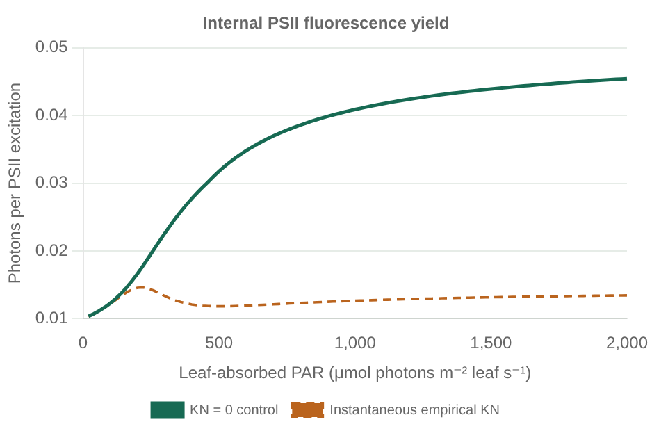
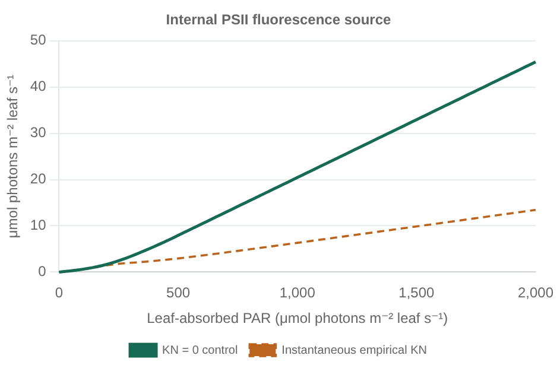

# PSII excitation and fluorescence

[Run the example](../examples/fluorescence.jl) or open the
[offline plots](examples.html#fluorescence). TOML reading and component assembly
live in [setup](../examples/setup/fluorescence.jl); all numerical choices are in
[the parameter file](../examples/parameters/fluorescence.toml).

The example has fixed temperature and prescribed biochemical-site CO₂. It obtains
PSII excitation Q₂ from the same `psii_fraction * absorbed_par` used by electron
transport, and realized linear flow J from `biochemical_turnover`. J is not the
potential electron supply and is not reconstructed from net carbon uptake. It
remains finite at the photorespiratory compensation point. Optional O₂ diagnostics
can remain disabled.

## Replaceable components

`RateCompetitionFluorescence <: AbstractFluorescence` contains explicit relative
rates and a concrete `AbstractQuenching{FT}` component. `ConstantQuenching` and
`SaturationQuenching` provide two choices; another law can implement
`quenching_rate(law, saturation)` without changing a switch or union. To use the
host coupling check, also define `fluorescence_low_light_yield` for that law's
rate-competition model, or supply a specialized coupling validator. The function
`fluorescence(model, PSIIFluxInputs(Q₂,J))` returns an immutable scalar result.
No field was added to `LeafModel`; callers compose this diagnostic alongside
photosynthesis. `NoFluorescence` returns `nothing` without input preparation.

For lit populations, ΦP=J/Q₂ and the nonphotochemical remainder is divided among
KF, KD and KN. Thus ΦF=(1−ΦP)KF/(KF+KD+KN), with analogous heat probabilities.
The inferred KP=ΦP(KF+KD+KN)/(1−ΦP) is checked against the declared maximum.
The four probabilities sum to one. They do **not** establish leaf joule conservation:
Stokes loss, thermalization and chemical-energy storage require additional accounting.

The empirical option uses relative saturation x=1−ΦP/ΦPmax and the KN curve in
van der Tol et al. (2014), Eq. 19. The example explicitly supplies the cotton fit,
KF=.05, KD=.95 and KPmax=4, giving ΦPmax=.8. This is a constant-KD illustration;
the paper also treats KD(T). Its PAM-derived fit has PSI-contamination limitations,
so this PSII-only use is an approximation, not a validated pure-PSII calibration.
All rate coefficients share a normalization; scaling every rate together leaves
the probabilities unchanged. [Primary paper](https://doi.org/10.1002/2014JG002713)

The new example supplies a compatible .8 low-light electron yield. Existing Bonan
exercises retain .85. `validate_fluorescence_coupling` rejects an incompatible
combination instead of retuning it. A constant positive KN requires its corresponding
quenched low-light electron yield; the empirical option requires the unquenched
maximum. Valid parameters can still be incompatible at a particular operating
point, so runtime checks remain necessary.

## Darkness, failure and floating point

`RateCompetitionResult{FT}` carries `FluorescenceStatus`, `boundary_roundoff`,
internal photon flux, four yields and inferred rates. `fluorescence_valid` accepts
lit and dark results. In exact darkness, Q₂=J=0, the computed photon flux is zero
but flux-derived yields and rates are NaN: they are undefined, not measured zero.
The example converts only these valid-dark yields to plot gaps and empty CSV cells.
An invalid result has NaN flux and fails example/report generation.

Negative/nonfinite inputs, nonzero J with zero excitation, or incompatible maximum
rates are explicit failures. Domain checks precede division and fractional powers.
The parameter file supplies an eight-epsilon yield tolerance for FT32/FT64. A
tolerated maximum-yield excess is flagged, preserving J/Q₂, inferred KP and emitted
photons; only an infinitesimally negative saturation coordinate uses x=0 in KN.
The quenched maximum is checked in yield units as well. ΦP≥1 is always rejected.
The tolerance is a numerical boundary policy, not a tunable physiological allowance.

## Connection to other models

`psii_flux_inputs` accepts a biochemical-site `LeafEnvironment`. For solved gas
exchange, first verify convergence, then construct that environment using accepted
Cc (`solution.biochemical_co2`). Ambient CO₂ is not interchangeable with Cc; no
ambient gas-environment overload is provided. A failed gas-exchange solve must not
be passed off as a valid fluorescence source.

The scalar photon flux is internal **PSII** production, before optical escape.
Spectral adapters must apply its yield once to the same PSII excitation bins,
then account for leaf-face escape, reabsorption and canopy transport separately.
This package contains no wavelength grid or spectral matrix dependency.

There is no prognostic NPQ memory, PSI emission, alternative sink or cyclic flow
in this component. A future coupled photosystem family is free to use richer
inputs and outputs instead of being forced through Q₂/J alone. Johnson & Berry's
model explicitly couples photosystems, Cyt-b6f and carbon metabolism, motivating
that boundary. [Primary article](https://pmc.ncbi.nlm.nih.gov/articles/PMC8292351/)

Tests cover independent high-precision rate reconstruction, compensation, dark/lit
reordering, normalization invariance, incompatible rates, numerical boundaries,
NoOp behavior, a downstream quenching extension, FT32/FT64 and CUDA execution.

