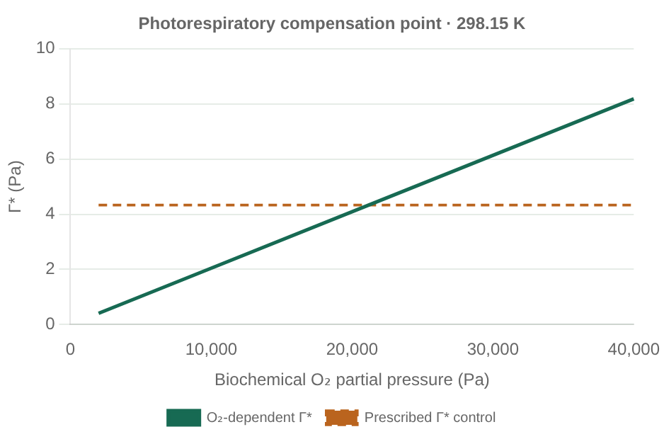
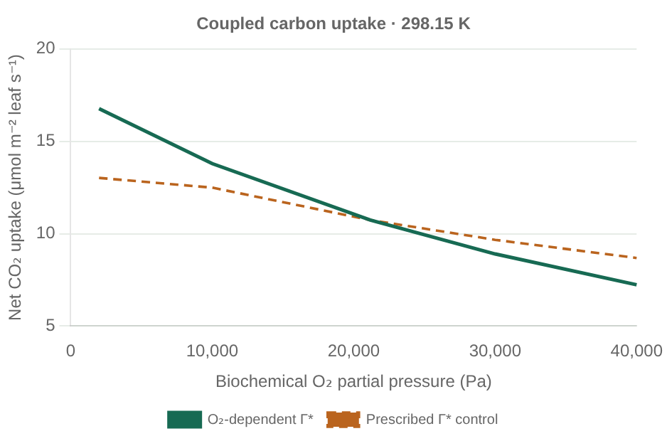

# Oxygen and the photorespiratory compensation point

The [short example](../examples/oxygen_response.jl) changes biochemical O₂ while
solving C3 gas exchange with prescribed temperature and humidity. The
[interactive gallery](examples.html#oxygen-response) compares an explicit
oxygen-dependent Γ* component with a prescribed-Γ* control. Select temperature
and Float32/Float64; all curves come from Julia, not browser-side equations.





## The physical component

Γ* is the CO₂ partial pressure where carboxylation balances photorespiratory CO₂
release. For photorespiratory release λ per oxygenation and **partial-pressure-based**
Rubisco specificity S, Γ* = λ O/S. At fixed temperature and unchanged specificity
and stoichiometry, this gives Γ*(T,O) = Γ*(T,Oref) O/Oref.
[Farquhar, von Caemmerer & Berry (1980), §4.2, Eq.38](https://biocycle.atmos.colostate.edu/Documents/SiB/Farquhar_1980.pdf).
The supplied reference temperature law must be calibrated at the explicit Oref
in Pa. There is no inferred ambient value or additional total-pressure factor.
A concentration-based specificity would require the corresponding solubility
conversion before using this pressure-based equation.

At Cc = Γ*, pre-respiration assimilation is zero and net assimilation is **−Rd**.
Gross carboxylation, photorespiratory turnover and linear electron flow can remain
positive. Γ* is therefore different from the net CO₂ compensation point when
respiration is nonzero. The oxygen budget uses realized turnover at the same Cc.

`PrescribedCompensationPoint(response)` explicitly retains a temperature-only
Γ* law. `OxygenScaledCompensationPoint(response, reference_oxygen)` scales that law
at the biochemical O₂ level. Both implement `AbstractCompensationPoint` and live
in the existing `C3TemperatureResponse.gamma_star` slot. They do not change the
`C3Photosynthesis` layout or the signed/clipped assimilation policy, which remains
a separate component named `compensation`.

Call `biochemical_rates(responses, T, O)` when oxygen affects Γ*. All production
environment-aware calculations use this interface: prescribed-CO₂ photosynthesis,
turnover, diffusion, equilibrium and fixed-O₂ sensitivities. The old two-argument
form remains valid for prescribed temperature responses, including custom user
extensions. It deliberately has no oxygen-dependent fallback. Disabling oxygen
diagnostics with `NoOxygenExchange` does **not** disable environmental O₂ in carbon
biochemistry or stomatal responses.

## Calibration and limits

This example keeps the existing Bonan-derived thermal calibration and declares
its reference O₂ partial pressure explicitly in
[oxygen_response.toml](../examples/parameters/oxygen_response.toml). The fixed-Γ*
curve away from that pressure is a controlled inconsistency demonstration, not a
second calibrated physiological prediction. It illustrates why changing Rubisco
competition alone does not represent a consistent oxygen perturbation.

Thermal calibration is replaceable. A recent sunflower study reports that the
method used to fit Γ*(T) can materially change the inferred temperature response;
it does not establish one new default for all vegetation.
[Moreno-Echeverry et al. (2026)](https://doi.org/10.1111/pce.70808).
No empirical coefficients from that study are silently substituted here.

The scalar scaled law returns zero at O=0, but full gas exchange with this
treatment is validated for **positive O₂ and Γ***. The present bounded equilibrium
solver requires Γ*>0; degenerate zero-O₂/zero-CO₂ limits and O₂ limitation of
respiration are separate work. No epsilon floor, internal O₂ diffusion, anaerobic
metabolism, acclimation or evolving atmospheric O₂ is implied.

## Validation and reproduction

Independent BigFloat temperature/specificity checks, reference-O₂ equivalence,
oxygenation/carboxylation and electron/O₂ stoichiometry, compensation-point turnover,
analytical diffusion residuals, equilibrium, fixed-O₂ conductance derivatives,
NoOp parity, type inference and zero warmed scalar allocations are tested in both
precisions. CPU/CUDA batches reorder dark and lit cases and retain native solver
diagnostics. The unchanged Bonan exercise remains covered by its existing oracle.
The full suite passes 35,348 CPU checks and 5,594 CUDA checks, including the
existing tests. Both independent reviewers cleared the scientific implementation
and example. The nine-plot gallery passes data, precision/temperature controls,
tables, series toggles, PNG export, mobile and offline browser checks. Existing
Bonan/stomatal/turnover CSVs and their seven previews remain byte-for-byte unchanged.
The [validation record](oxygen_response_validation.json) pins sources, software,
tests and the separate code/biophysics reviews.

```sh
julia --project=. examples/oxygen_response.jl
julia --project=. test/runtests.jl
julia --project=test/gpu test/gpu/runtests.jl
julia --project=. docs/build_examples.jl
```

Main examples call the biophysics. Setup, TOML loading and table writing remain
in `examples/setup/`; no I/O, grid or device dependency enters the core package.
